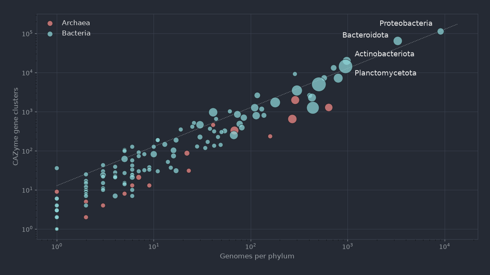
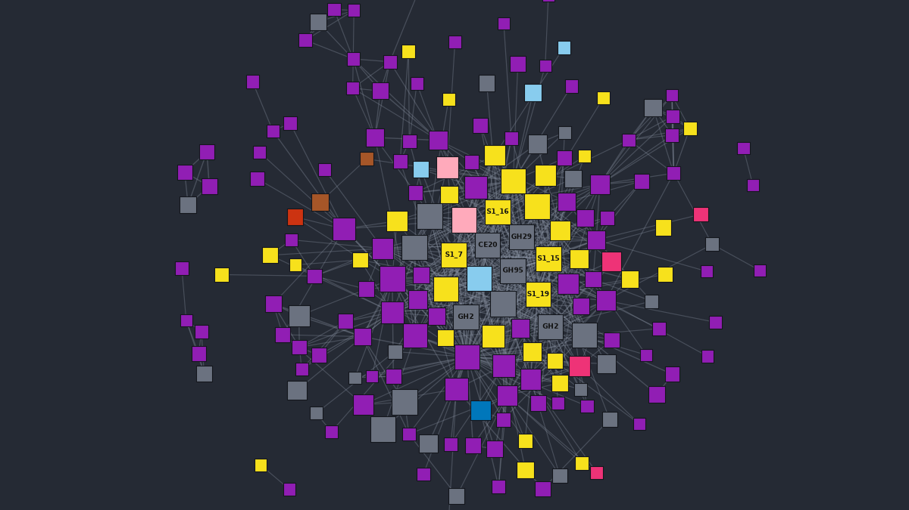
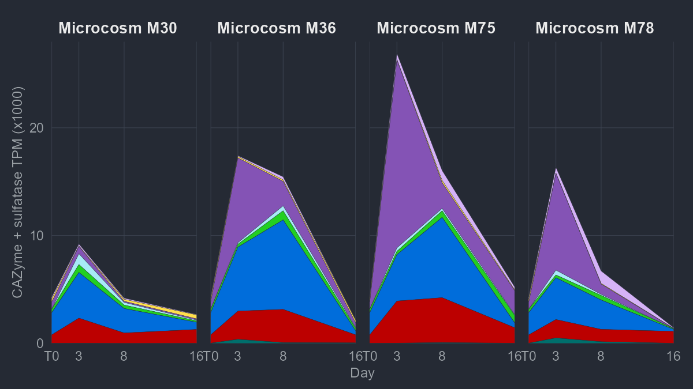
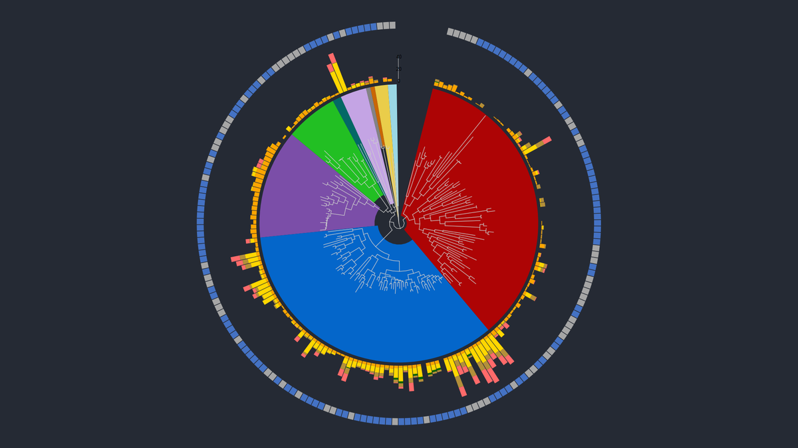

Each notebook rebuilds the main analyses of a paper from the processed data in
its GitHub repository. The R notebooks are rendered like R Markdown reports,
and the Python notebooks like Jupyter notebooks. Most charts are interactive
(hover, filter, zoom), the code behind each figure can be read, and the tables
can be searched and downloaded.

```{=html}
<div class="nb-tree">
<div class="nb-tree-head"><span>Name</span><span>Language</span><span>Publication</span></div>

<div class="nb-row">
<div class="nb-name"><a class="nb-thumb" href="mpcgc.html" tabindex="-1"></a><div><a class="nb-file" href="mpcgc.html"><i class="bi bi-journal-code"></i>mpcgc.qmd</a>
<div class="nb-desc">mpCGCdb: 289,962 CAZyme gene clusters from 22,607 marine genomes. Figures from the preprint, with live views from the database.</div></div></div>
<span class="nb-meta">Python, Nextflow</span>
<span class="nb-meta"><a href="https://doi.org/10.64898/2026.09.21.753266">Oliver <i>et al.</i> 2026, <i>bioRxiv</i></a><br><a class="nb-pub" href="https://aaronoliver.dev/publications/mpCGC2026">Publication page</a></span>
</div>
<div class="nb-row">
<div class="nb-name"><a class="nb-thumb" href="kiritimatiellia-scone.html" tabindex="-1"></a><div><a class="nb-file" href="kiritimatiellia-scone.html"><i class="bi bi-journal-code"></i>kiritimatiellia-scone.qmd</a>
<div class="nb-desc">Similarity-colocalization networks (SCoNes): the method built step by step with igraph, then applied to 898 Kiritimatiellia genomes.</div></div></div>
<span class="nb-meta">Python, igraph</span>
<span class="nb-meta"><a href="https://doi.org/10.64898/2026.10.06.756941">Oliver <i>et al.</i> 2026, <i>bioRxiv</i></a><br><a class="nb-pub" href="https://aaronoliver.dev/publications/Kiritimatiellia2026">Publication page</a></span>
</div>
<div class="nb-row">
<div class="nb-name"><a class="nb-thumb" href="enrichments-metatranscriptomics.html" tabindex="-1"></a><div><a class="nb-file" href="enrichments-metatranscriptomics.html"><i class="bi bi-file-earmark-text r"></i>enrichments-metatranscriptomics.qmd</a>
<div class="nb-desc">Genome-resolved metatranscriptomics of <i>Kyphosus</i> gut microcosms: which of 471 MAG populations express which enzymes, and when.</div></div></div>
<span class="nb-meta">R, plotly</span>
<span class="nb-meta"><a href="https://doi.org/10.1128/mbio.03382-25">Plominsky, Oliver <i>et al.</i> 2026, <i>mBio</i></a><br><a class="nb-pub" href="https://aaronoliver.dev/publications/KyphosusMicrocosms2026">Publication page</a></span>
</div>
<div class="nb-row">
<div class="nb-name"><a class="nb-thumb" href="kyphosus-mags.html" tabindex="-1"></a><div><a class="nb-file" href="kyphosus-mags.html"><i class="bi bi-file-earmark-text r"></i>kyphosus-mags.qmd</a>
<div class="nb-desc">MAGs from wild <i>Kyphosus</i> guts and bioreactors: phylogenomics, CAZyme and sulfatase novelty, SCFA pathways and BGCs.</div></div></div>
<span class="nb-meta">R, ggtree</span>
<span class="nb-meta"><a href="https://doi.org/10.1128/mbio.00496-24">Oliver <i>et al.</i> 2024, <i>mBio</i></a><br><a class="nb-pub" href="https://aaronoliver.dev/publications/Krumbs2024">Publication page</a></span>
</div>
</div>
```
