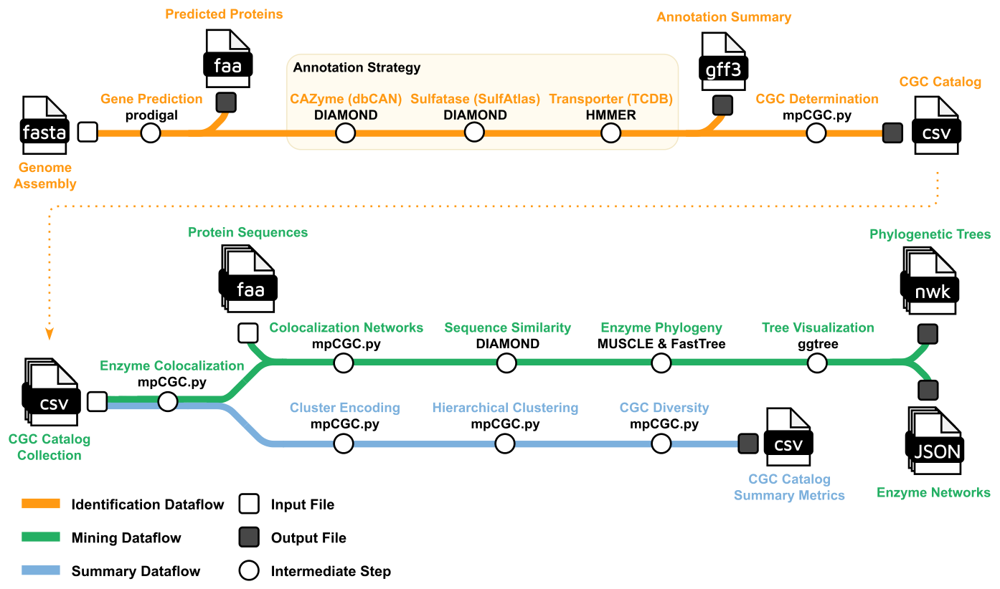
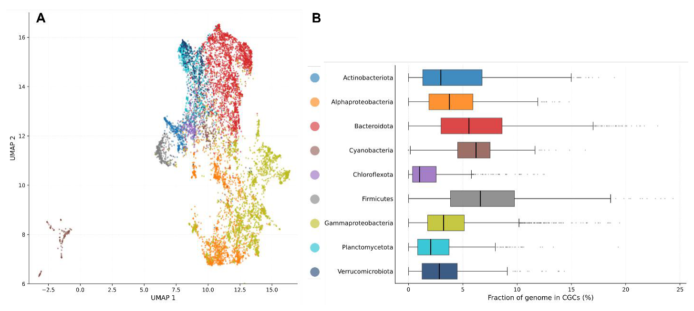
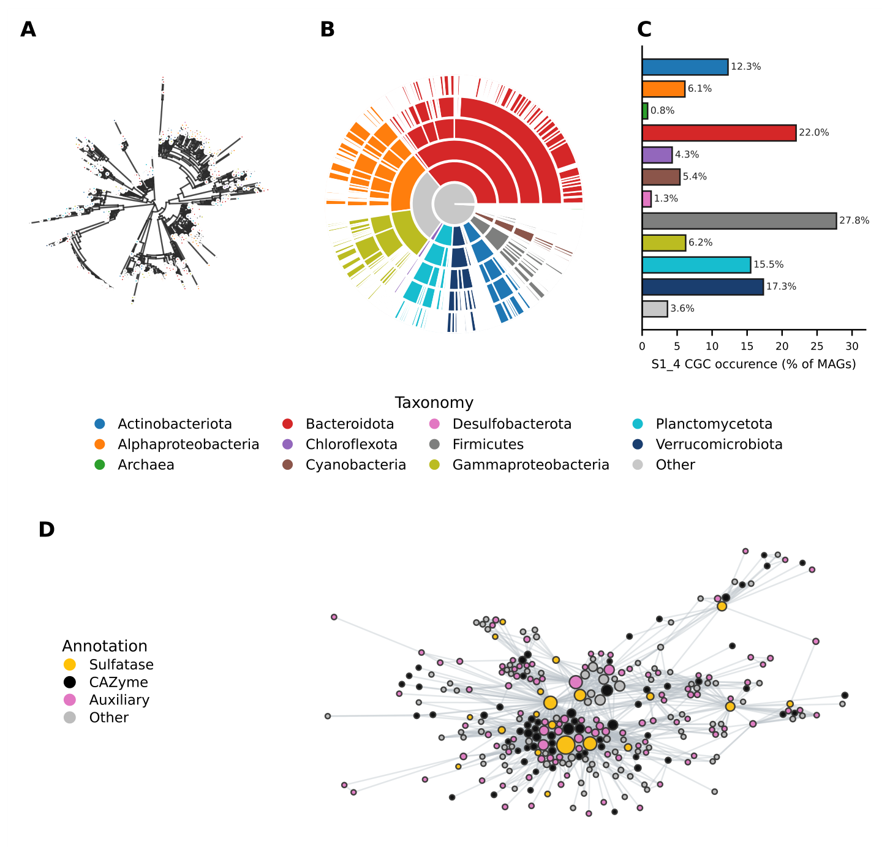
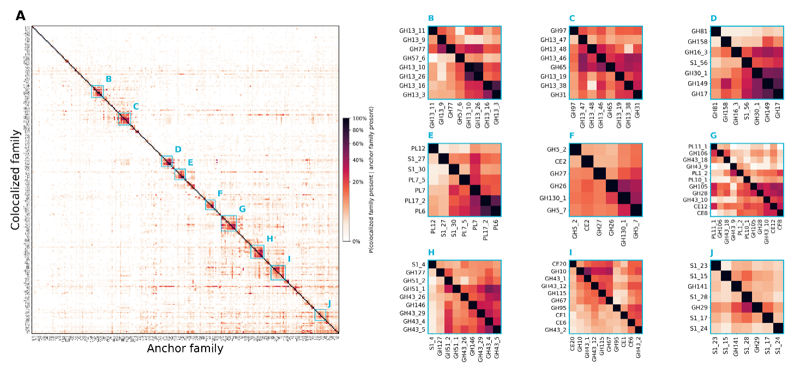

```{=html}
<div class="jp-header"><span class="jp-name">mpcgc.qmd</span><span class="jp-saved">Oliver, Podell &amp; Allen 2026</span><span class="jp-kernel">Python 3 (ipykernel)</span></div>
```

# mpCGCdb: polysaccharide-utilization gene clusters across the ocean


::: {.paper-links}
[Preprint: Oliver, Podell & Allen 2026, *bioRxiv*](https://doi.org/10.64898/2026.09.21.753266)
[Database: mpcgcdb.com](https://mpcgcdb.com)
[Code: mpCGC pipeline](https://github.com/AaronAOliver/mpCGC)
[Data: Zenodo](https://doi.org/10.5281/zenodo.20219284)
:::

Bacteria break down polysaccharides with CAZyme gene clusters (CGCs):
neighboring genes for glycoside hydrolases, lyases, sulfatases and
transporters that act on one glycan together. Many marine glycans (carrageenan,
fucoidan, ulvan) carry sulfate groups that must be removed before the sugars
are usable, so marine CGCs often include sulfatases that CAZyme-only tools
miss.

mpCGCdb is a web catalog of marine CGCs that I built from the Global Ocean
Microbiome Catalog with my Nextflow pipeline, mpCGC. It is more than 15
times larger than the previous marine CGC resource, and it covers sulfatases
and lineages beyond Bacteroidota. The figures below come from the preprint,
and the interactive views come from [mpcgcdb.com](https://mpcgcdb.com).

```{python}
import math
from pathlib import Path
import pandas as pd
import plotly.express as px
from _common import show, SITE_TEAL

A = Path("assets/mpcgc")   # tables parsed from https://mpcgcdb.com/statistics/
provenance = pd.read_csv(A / "mpcgcdb_stats_provenance.tsv", sep="\t")
classes = pd.read_csv(A / "mpcgcdb_stats_classes.tsv", sep="\t")
classes = classes[classes.Class != "Total (distinct)"]   # drop the summary row
phyla = pd.read_csv(A / "mpcgcdb_stats_phyla.tsv", sep="\t")

# where the 22,607 genomes come from
provenance.style.hide(axis="index").format(thousands=",")
```

```{python}
# headline numbers; the last three are totals reported on the statistics page
summary = pd.DataFrame({"Value": [
    f"{provenance.Genomes.sum():,}",
    f"{len(phyla)}",
    f"{classes['Families and subfamilies'].sum()}",
    "289,962",
    "2.44 million",
    "579",
]}, index=["Genomes", "Phyla", "GH, PL, CE and S1 families and subfamilies",
           "CAZyme gene clusters", "Proteins in clusters", "Interactive phylogenies"])
summary
```

## The mpCGC pipeline

::: {.paper-figure}
{width="100%"}
:::

Genes are predicted with Pyrodigal and annotated by DIAMOND and PyHMMER
against dbCAN (CAZymes), SulfAtlas (sulfatases) and TCDB (transporters). A
seed-and-extend algorithm then joins co-localized enzymes and transporters into
clusters. The pipeline runs on conda, Docker, Singularity or Slurm, so the same
workflow scaled to all 22,607 genomes. Its code is on
[GitHub](https://github.com/AaronAOliver/mpCGC).

## Database contents

These counts come from the [mpCGCdb statistics page](https://mpcgcdb.com/statistics/).
Hover over a point or bar for its values.

```{python}
phyla["CGCs per genome"] = phyla.CGCs / phyla.Genomes
fig = px.scatter(phyla, x="Genomes", y="CGCs", size="CGCs per genome", color="Domain", log_x=True, log_y=True,
                 hover_name="Phylum", hover_data={"Classes": True, "CGCs per genome": ":.1f"},
                 color_discrete_map={"Bacteria": SITE_TEAL, "Archaea": "#f89406"}, size_max=28,
                 labels={"Genomes": "Genomes with at least 1 CGC", "CGCs": "CGCs"})
offsets = [(-40, -25), (-45, -25), (-70, -30), (60, 30)]   # label the four largest phyla without overlap
for (_, r), (ax, ay) in zip(phyla.head(4).iterrows(), offsets):
    fig.add_annotation(x=math.log10(r.Genomes), y=math.log10(r.CGCs), text=r.Phylum,
                       showarrow=True, arrowhead=0, ax=ax, ay=ay, font=dict(size=11))
fig.update_xaxes(dtick=1)
fig.update_yaxes(dtick=1)
fig.update_layout(height=470, legend=dict(itemsizing="constant"),
                  title=dict(text=f"All {len(phyla)} phyla: genomes vs. clusters (bubble size = CGCs per genome)",
                             font=dict(size=13)))
show(fig)
```

```{python}
fams = pd.read_csv(A / "mpcgcdb_stats_top_families.tsv", sep="\t")
names = {"GH": "Glycoside hydrolase", "CE": "Carbohydrate esterase", "PL": "Polysaccharide lyase", "S1": "Sulfatase"}
fams["Class"] = fams.Class.map(names)
class_colors = {"Glycoside hydrolase": SITE_TEAL, "Polysaccharide lyase": "#62c462",
                "Carbohydrate esterase": "#b38bd6", "Sulfatase": "#f89406"}
fig = px.bar(fams, x="CGCs", y="Family", color="Class", orientation="h", color_discrete_map=class_colors,
             category_orders={"Family": fams.sort_values("CGCs", ascending=False).Family.tolist()},
             labels={"CGCs": "CGCs containing the family", "Family": "", "Class": "Enzyme class"})
fig.update_layout(height=520, title=dict(text="The 20 most common enzyme families in CGCs", font=dict(size=13)),
                  legend=dict(orientation="h", y=-.12))
show(fig)
```

GH13 (α-amylases), the multifunctional GH3 and GH23 (lytic transglycosylases)
are the most common families in clusters. Among sulfatases, S1_6, S1_8 and S1_2
lead. More than 3,000 genomes carry over 25 CGCs each.

### Browse by taxonomy

The interactive taxonomy sunburst from the mpCGCdb home page. Click a ring to
zoom into that lineage.

<div class="embed-wrap"><iframe class="embed-frame" style="height:580px" src="assets/mpcgc/views/taxonomy_sunburst.html" loading="lazy" title="mpCGCdb taxonomy sunburst"></iframe><div class="embed-shield" onclick="this.remove()">Click to interact</div></div>

## Undiscovered cluster diversity

::: {.paper-figure}
{width="100%"}
:::

Firmicutes, Bacteroidota and Planctomycetota hold the richest sets of
cluster types, and Cyanobacteria, Desulfobacterota and Archaea the poorest.
Chao2 estimates predict more than 9,000 distinct CAZyme and sulfatase
arrangements in marine Bacteroidota and more than 4,000 in Planctomycetota.
Current metagenomes capture under 40% of them.

## Phylum-specific signatures

::: {.paper-figure}
{width="100%"}
:::

Phylum explains about 12% of the variation in cluster composition (PERMANOVA
pseudo-F = 169.8, p < 0.001), but the groups overlap rather than separate
cleanly. Every major phylum includes genomes with a large share of their
genes in CGCs: 1,070 genomes have more than 10%. Many are uncharacterized
strains, such as *Cohnella* sp. CIP 111063 (24.3%) and *Sedimentisphaera
salicampi* (19.3%), which are candidates for cultivation.

## The S1_4 sulfatase

::: {.paper-figure}
{width="100%"}
:::

Every enzyme family and subfamily in mpCGCdb has a page with these views.
The interactive versions for S1_4 are below. They are copies of
[mpcgcdb.com/S1_4](https://mpcgcdb.com/S1_4/) as of October 2026. S1_4 occurs
in clusters in 27.8% of Firmicutes and 22% of Bacteroidota genomes, but only
6.1% of Proteobacteria. Flavobacteriaceae form their own clade in the tree.
The sulfatase colocalizes most often with S1_7, S1_16 and S1_8.

::: {.panel-tabset}
### Phylogeny
<div class="embed-wrap"><iframe class="embed-frame" style="height:780px" src="assets/mpcgc/views/s1_4_phylogeny.html" loading="lazy" title="S1_4 phylogeny"></iframe><div class="embed-shield" onclick="this.remove()">Click to interact with the tree</div></div>

### Taxonomy sunburst
<div class="embed-wrap"><iframe class="embed-frame" style="height:620px" src="assets/mpcgc/views/s1_4_sunburst.html" loading="lazy" title="S1_4 sunburst"></iframe><div class="embed-shield" onclick="this.remove()">Click to interact</div></div>

### Host prevalence
<div class="embed-wrap"><iframe class="embed-frame" style="height:520px" src="assets/mpcgc/views/s1_4_host_prevalence.html" loading="lazy" title="S1_4 host prevalence"></iframe><div class="embed-shield" onclick="this.remove()">Click to interact</div></div>

### Colocalization network (SCoNe)
<div class="embed-wrap"><iframe class="embed-frame" style="height:760px" src="assets/mpcgc/views/s1_4_scone.html" loading="lazy" title="S1_4 SCoNe"></iframe><div class="embed-shield" onclick="this.remove()">Click to interact with the network</div></div>
:::

## Enzyme colocalization

::: {.paper-figure}
{width="100%"}
:::

Families that share a substrate cluster together. The blocks along the
diagonal match α-glucan, β-glucan, alginate and glycosaminoglycan, mannan,
pectin, arabinan, xylan and fucan pathways. Lineages specialize:
Bacteroidota in α- and β-glucans, Verrucomicrobiota and Planctomycetota in
sulfated fucans, and Firmicutes in pectin. Several sulfatase subfamilies
with no assigned EC number appear in these modules. S1_23, S1_24 and S1_28
likely act on sulfated fucans, while S1_30 and S1_56 sit with laminarin and
alginate enzymes. These associations suggest substrates for uncharacterized
sulfatases.

::: {.callout-tip}
## More data
[mpcgcdb.com](https://mpcgcdb.com) has a page for every enzyme family, lineage,
genome and gene cluster, with a gene map for each cluster. Bulk annotations are
on [Zenodo](https://doi.org/10.5281/zenodo.20219284), and the pipeline can be
installed with `nextflow run AaronAOliver/mpCGC`.
:::
