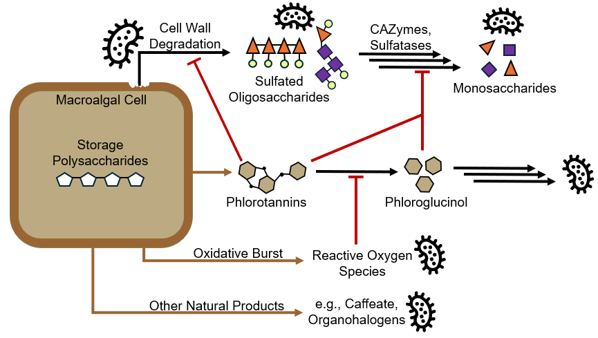
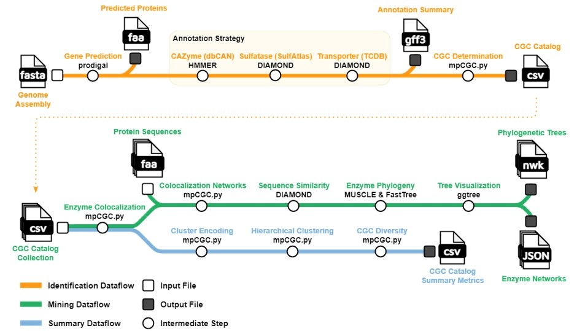
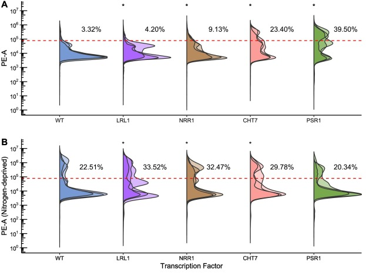
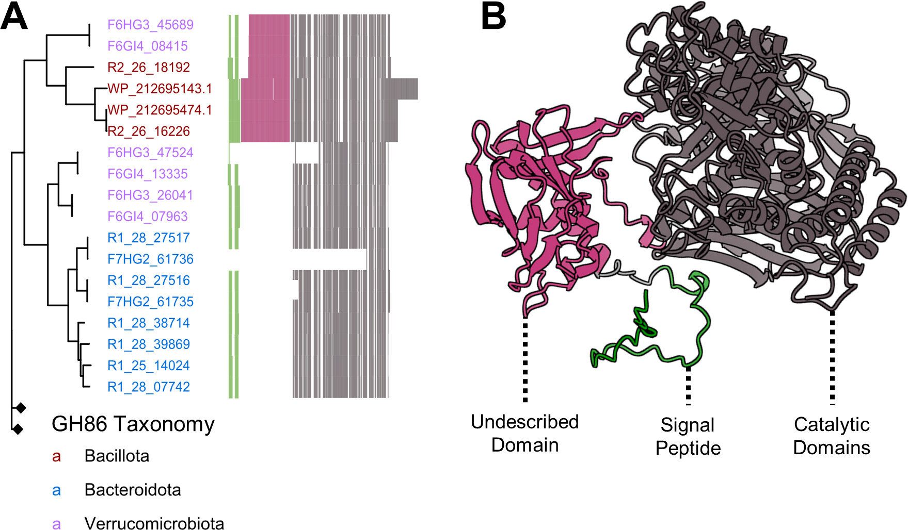

Hello! I'm Aaron, a bioinformatician and recent PhD recipient from the University of California San Diego. For eight years, I've performed computational biology research at the [Center for Marine Biotechnology and Biomedicine](https://scripps.ucsd.edu/cmbb) of Scripps Institution of Oceanography. Most recently, I was a [USDA National Institute of Food and Agriculture Research Fellow](https://www.nifa.usda.gov/about-nifa/award-announcements/nifa-awards-74m-predoctoral-fellowships-support-future-leaders), developing genomics algorithms to monitor marine agriculture for pests and disease vectors.

Before starting my PhD, I received my bachelor's degree in Bioinformatics at UC San Diego. I worked as an [instructional assistant](/teaching/) for two years at the Jacobs School of Engineering
during undergrad. My specialty was the theoretical bases of computer science, with a focus on [discrete mathematics](/teaching/CSE20), [computational complexity](/teaching/CSE21), and [algorithm design](/teaching/CSE101).
I use my background in computer science to explore communities of marine microorganisms for potential applications in biotechnology, bioenergy, and biomaterials.

<h2 id="education">Education</h2>
<ul class="edu-list">
<li><i class="fas fa-graduation-cap" aria-hidden="true"></i>
PhD in Marine Biology, 2026Scripps Institution of Oceanography, UC San DiegoDissertation: <i>The genomics of marine microbial macroalgivores</i>
</li>
<li><i class="fas fa-graduation-cap" aria-hidden="true"></i>
BS in Bioinformatics, 2021University of California San Diego
</li>
</ul>

<h2 id="interests">Interests</h2>
<ul class="interest-list">
<li>Metagenomics and metatranscriptomics</li>
<li>Algorithms for enzyme discovery</li>
<li>Environmental and algal biotechnology</li>
<li>Microbiome manipulation for human and animal health</li>
</ul>

<h2 id="projects">Bioinformatics projects</h2>






## Research Aims
I love collaboration, so my time is split between many projects! My dissertation focused on the strategies used by microbes to degrade algal polysaccharides and defense chemicals. These enzymes and compounds
have implications in aquaculture, carbon sequestration, and marine ecosystem dynamics. Beyond my dissertation, I partner with corporate R&D teams, government labs, 
and academic research groups as both a generalist bioinformatician and a microbial genomics specialist.

<figure class="fig-card">

<figcaption>Study systemThe defensive cascade of interactions between algal cells and their microbiomes</figcaption>
</figure>

### Microbiome decomposition of macroalgal polysaccharides and antimicrobials
My dissertation work focused on the sugars inside seaweeds, which are notoriously difficult to break down using physical or chemical treatments. I used the gut of the
[herbivorous Hawaiian chub](https://www.hawaiisfishes.com/fish_of_month/past_fom/fom_05_04.htm) as a model system for studying the bacteria that simultaneously degrade wide varieties of algal sugars and
detoxify the antimicrobial compounds released by stressed seaweeds. These microbial communities can survive for multiple weeks in batch-fed bioreactors [(see my dissertation chapter)](/publications/Krumbs2024),
enabling direct manipulation of seaweed-degrading microbiomes. Using this paired natural fish/bioreactor model system, my dissertation examined the temporal dynamics, microbiogeography, genome organization, and enzyme evolution 
behind seaweed biomass consumption.

<figure class="fig-card">

<figcaption>DissertationA pipeline for identifying macroalgal polysaccharide degradation gene clusters (<a href="/notebooks/mpcgc.html">interactive notebook</a>)</figcaption>
</figure>

### Microalgal genomics and genetic engineering toolkits
I am also interested in developing genomic resources and genetic engineering platforms for commercially relevant green microalgae strains. 
I collaborate with molecular biologists at the [California Center for Algal Biotechnology](https://algae.ucsd.edu/) and the [J. Craig Venter Institute](https://www.jcvi.org/research/environmental-sustainability#projects)
to catalog the resilience of [novel <i>Chlamydomonas</i> strains](/publications/CpacGenome2025). Some strains display 
promising tolerance to temperature, pH, salt, and light conditions that limit the growth of similar algae used by algaculture farms.
As a bioinformatician in one branch of this project, I use their assembled genomes to identify genes that 
enable this extremophile tolerance. I also develop computational tools for genetic engineering of these algae strains, which enable [a 2.4-fold increase in triglycerides](/publications/CpacTF2025)
and microalgae that are able to [degrade polyethylene terephthalate microplastics](/publications/Recombinant2025).

<figure class="fig-card">

<figcaption>CollaborationImproving lipid accumulation in genetically engineered green microalgae</figcaption>
</figure>

### Sustainable biotechnology applications
I often partner with Californian and Hawaiian biotechnology companies to extend the impact of my research. Much of my dissertation work was done in tandem with applied scientists
at the Kona mariculture firm [Ocean Era](http://ocean-era.com/), to use partially degraded macroalgal biomass as a sustainable feed for carnivorous fish farms. My bioinformatics support work in green microalgae
enables automated pathogen monitoring systems for the outdoor commercial ponds of Hawaiian algaculture company [Global Algae](https://www.globalgae.com/).

More recently, I have built computational platforms for genetic manipulation of a proprietary algae strain used by [Algenesis](https://www.algenesislabs.com/), a local 
biomaterials startup that produces 100% biodegradable algae-based plastics. Previously, I worked with [BASF's enzyme division](https://www.basf.com/us/en/media/smart-scientists/Enzymes) on an ongoing grant from the Department of 
Energy to [halve the carbon footprint of industrial surfactant production](https://www.energy.gov/sites/default/files/2024-11/beto-MACRO-FOA-Scripps.pdf) using marine enzymes identified in my dissertation.

<figure class="fig-card">

<figcaption>PartnershipHeterologous expression of novel marine enzymes (e.g. β-porphyranase) for biofoundries</figcaption>
</figure>
