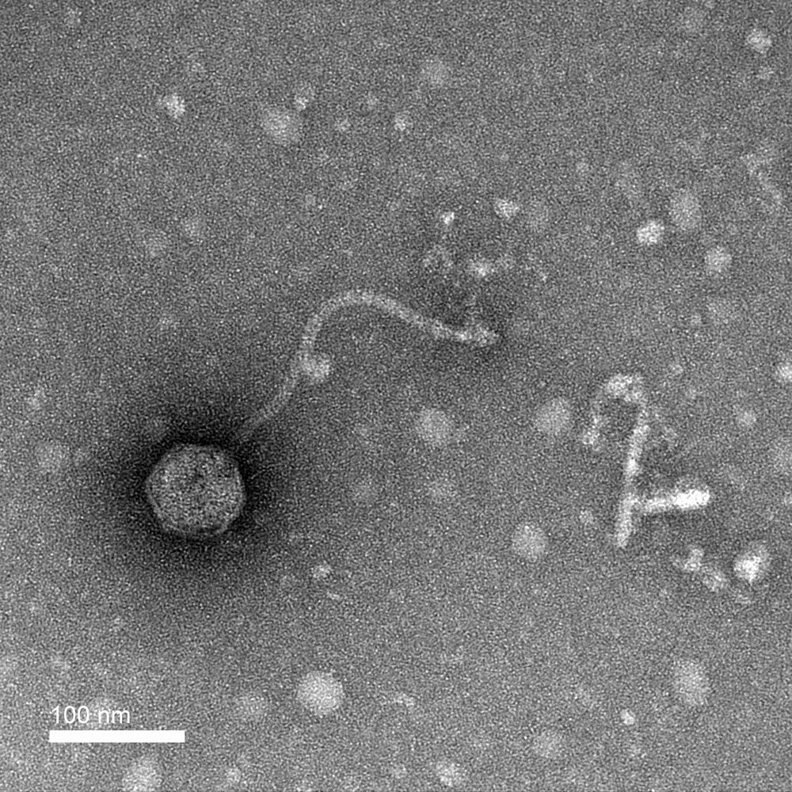

Genome and proteome annotation of the <i>Streptomyces</i> phage Darolandstone, done as part of the [SEA-PHAGES](https://seaphages.org/) program.
Results from this project were also presented as part of a larger collaboration at the [10th Annual SEA Symposium](https://seaphages.org/meetings/31/)
in Ashburn, VA.

[View the poster](https://imgur.com/6apnQX8)

I also isolated a phage of my own, Palm, shown here in an electron micrograph:

<figure class="fig-card">

<figcaption>Phage PalmElectron micrograph of my phage isolate, Palm</figcaption>
</figure>
